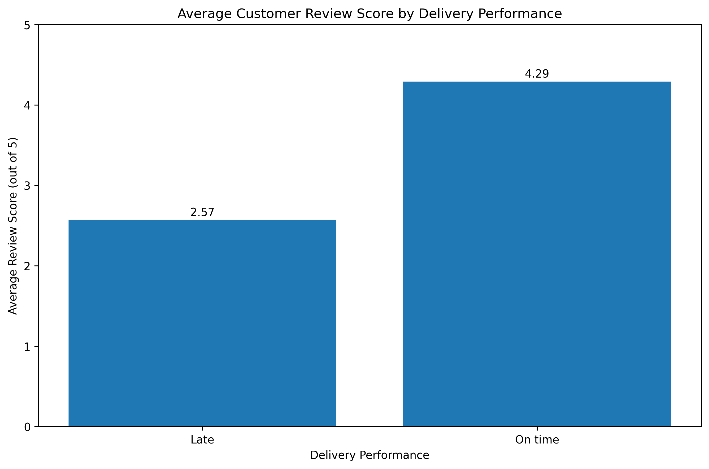

# Brazilian E-Commerce Analysis

An exploratory analysis of Brazilian e-commerce data focused on customer purchasing behavior, sales, payment preferences, product categories, delivery performance, and customer reviews.

## Project overview

This project assesses the quality of the source data, prepares cleaned datasets, and analyzes the resulting customer and order records. The analysis uses nine related datasets covering customers, orders, order items, payments, reviews, products, sellers, geolocation, and product category translations.

**Tools:** Python, pandas, NumPy, Matplotlib, Seaborn, Jupyter Notebook, and SQL.

## Key findings

- **Repeat purchasing was uncommon:** 3.12% of 96,096 unique customers placed more than one order in the observed data.
- **Total order value was about R$15.84 million:** R$13.59 million in product sales plus R$2.25 million in freight. Average order value was R$160.58, while the median was R$105.29.
- **Credit cards dominated payment value:** 78.34% of recorded payment value was paid by credit card; boleto accounted for 17.92%.
- **Health & Beauty led product revenue:** it generated R$1.26 million, followed by Watches & Gifts at R$1.21 million.
- **Late deliveries were associated with lower review scores:** among 95,824 delivered orders with complete delivery dates and review data, 92.01% arrived on time. Average review scores were 4.29/5 for on-time deliveries and 2.57/5 for late deliveries.

These are historical dataset results, not estimates of current business performance. The delivery and review comparison shows an association, not proof that delays alone caused lower ratings.

## Repository contents

| Path | Description |
|---|---|
| `notebooks/01_data_quality_assessment.ipynb` | Data quality checks and initial exploration |
| `notebooks/02_data_cleaning.ipynb` | Data cleaning, standardization, and validation |
| `notebooks/03_data_analysis.ipynb` | Customer, sales, payment, product, delivery, and review analysis |
| `data/raw/` | Source CSV files |
| `data/working/` | Intermediate CSV files used during cleaning |
| `data/cleaned/` | Cleaned CSV files used in the analysis |
| `sql/` | SQL table creation, data loading, and analysis scripts |
| `reports/decision_brief.md` | Executive summary, recommendations, and limitations |
| `reports/data_dictionary.md` | Dataset and column definitions |
| `reports/SQL, statistics and data storytelling Executive brief.pdf` | PDF executive brief |
| `reports/figures/` | Analysis charts |

## Selected visualizations

### Average review score by delivery performance



### Top product categories by revenue


### Payment value by payment method


## Run the notebooks

1. Clone or download this repository and open a terminal in its root directory.
2. Install Python and the notebook dependencies:

   ```bash
   python -m pip install pandas numpy matplotlib seaborn notebook
   ```

3. Start Jupyter from the `notebooks` directory so the notebooks' relative data paths resolve:

   ```bash
   cd notebooks
   jupyter notebook
   ```

4. Open and run the notebooks. The cleaning notebook reads from `../data/working/` and writes cleaned files to `../data/cleaned/`; the analysis notebook reads from the cleaned folder.

**Data path note:** The data quality notebook currently expects its CSV files directly inside `data/` (for example, `data/olist_orders_dataset.csv`). The provided files are organized into `data/raw/`, `data/working/`, and `data/cleaned/`. To run that notebook as written, place or copy the required source CSVs in the expected location, or update its input paths.

## Reports

- [Decision brief](reports/decision_brief.md)
- [Data dictionary](reports/data_dictionary.md)
- [Executive brief (PDF)](reports/SQL%2C%20statistics%20and%20data%20storytelling%20Executive%20brief.pdf)

## Limitations

- Spending metrics use 98,666 orders with available order-item records; orders without item records are excluded.
- Repeat purchasing is measured over the available observation period and is not adjusted for customer tenure or purchase opportunities.
- Multiple review scores for an order were averaged for the delivery comparison.
- Two untranslated product categories were assigned analyst-provided English labels; records without category information were retained as **Unknown Category**.
- The analysis is descriptive and does not establish causal relationships.
